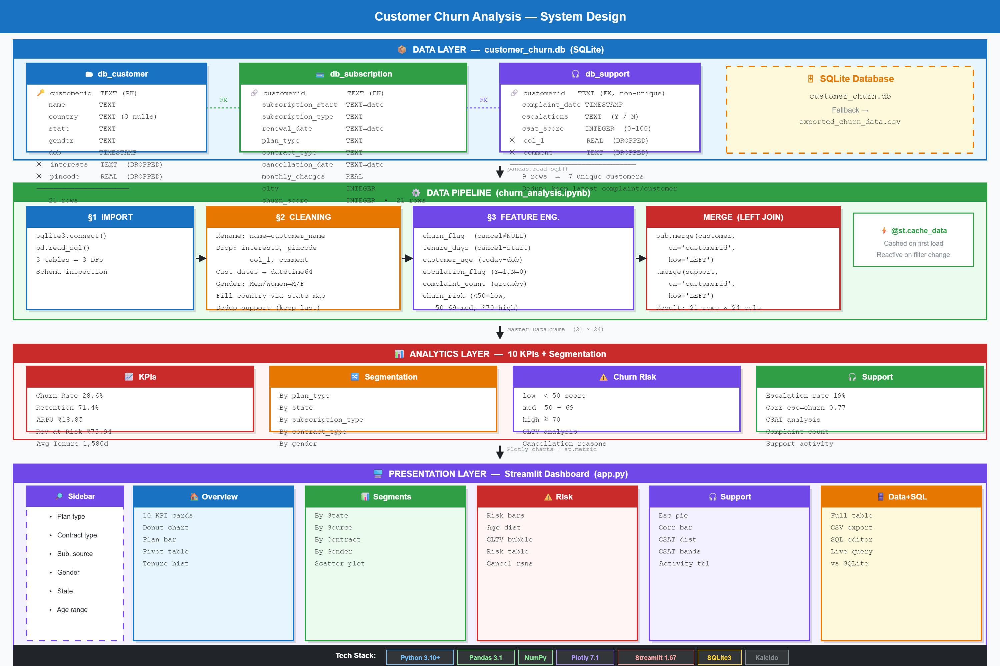
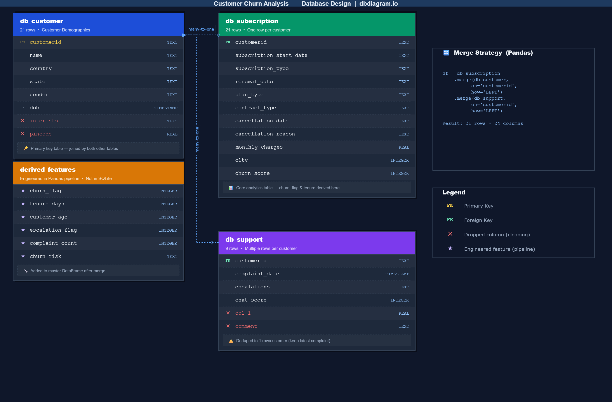
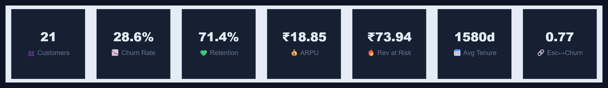
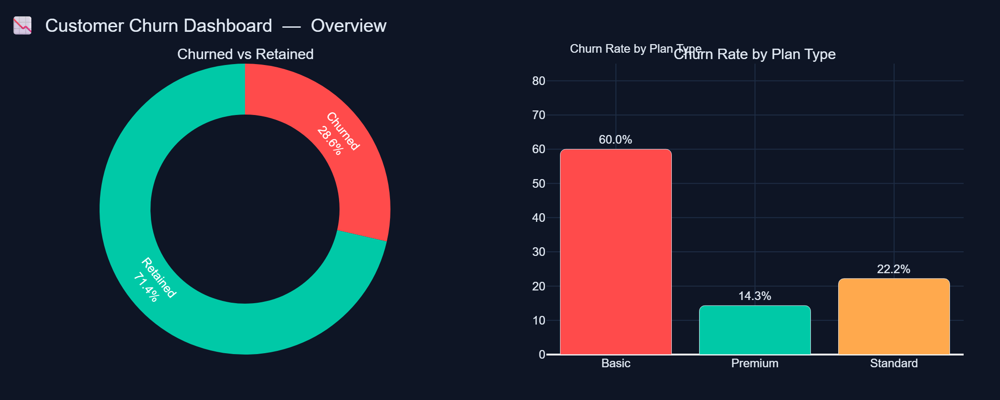
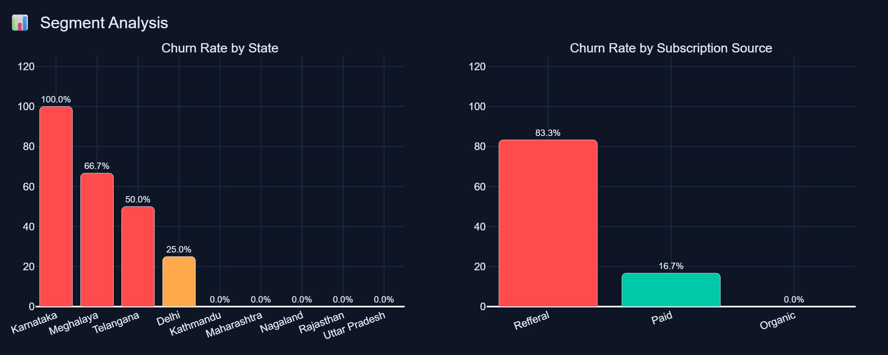
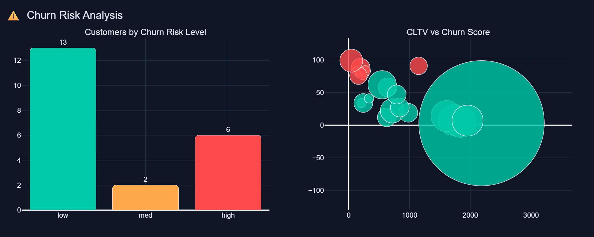
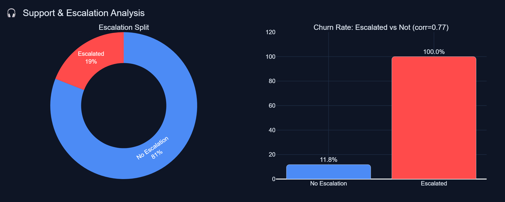
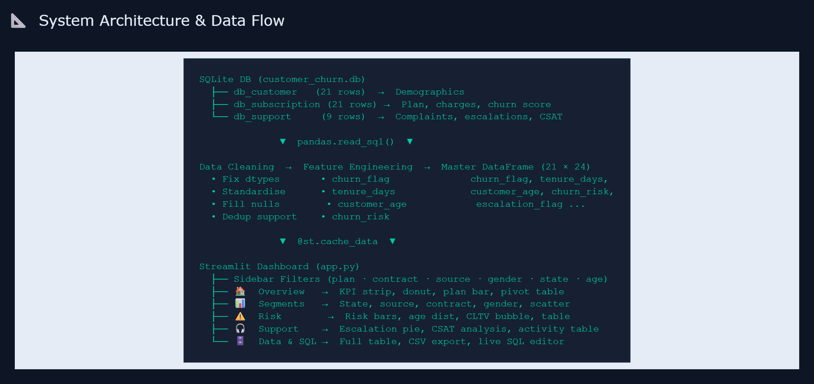

# 📉 Customer Churn Analysis

> End-to-end data analysis project: SQLite → Pandas → Streamlit interactive dashboard

[](https://python.org)
[](https://streamlit.io)
[](https://plotly.com)
[](https://pandas.pydata.org)
[](LICENSE)
[](https://sqlite.org)

---

## 📐 System Design



> Interactive version → open [`system_design.excalidraw`](system_design.excalidraw) at **[excalidraw.com](https://excalidraw.com)** · drag & drop the file to edit

---

## 🗺️ Database Design



> Full DBML source → [`database_design.dbml`](database_design.dbml)  
> Paste it at **[dbdiagram.io](https://dbdiagram.io)** to get the interactive version.

---

## 🖼️ Dashboard Preview

### KPI Strip


### Overview — Churned vs Retained & Plan Analysis


### Segment Analysis


### Churn Risk Analysis


### Support & Escalation Analysis


### System Architecture


---

## 📌 Project Overview

This project simulates a real-world **customer churn analysis pipeline** for a subscription business (OTT / SaaS). Starting from a raw SQLite database with three normalised tables, it walks through every stage a data analyst performs:

1. **Data Import** — extract 3 tables from SQLite into Pandas DataFrames
2. **Data Cleaning** — rename columns, drop junk cols, fix dtypes, standardise gender, impute missing countries
3. **Feature Engineering** — derive `churn_flag`, `tenure_days`, `customer_age`, `escalation_flag`, `churn_risk`
4. **Analytics** — 10 KPI calculations + multi-dimensional segmentation
5. **Visualisation** — Matplotlib/Seaborn in notebook → interactive Plotly in Streamlit dashboard
6. **Interactive Dashboard** — fully filterable Streamlit app with 5 tabs

---

## 🗂️ Repository Structure

```
customer-churn-analysis/
│
├── 📓 churn_analysis.ipynb       ← Main Jupyter notebook (4 sections)
├── 🗄️  customer_churn.db          ← SQLite source database (3 tables)
├── 📊 exported_churn_data.csv    ← Pre-merged CSV fallback
│
├── files/
│   └── 🐍 app.py                 ← Streamlit dashboard (5 tabs)
│
├── screenshots/                  ← Dashboard preview images
│   ├── 01_overview.png
│   ├── 02_segments.png
│   ├── 03_risk.png
│   ├── 04_support.png
│   ├── 05_architecture.png
│   └── 06_kpi_strip.png
│
├── 📐 architecture.md            ← System design & data flow diagrams
├── 📋 case_study.md              ← Full business case study
├── 📦 requirements.txt           ← Python dependencies
├── 📄 LICENSE                    ← MIT
└── 🚫 .gitignore
```

---

## 🗃️ Database Schema

```
customer_churn.db
│
├── db_customer  (21 rows)
│   ├── customerid  PK
│   ├── name, country, state
│   ├── gender  (Male / Female)
│   └── dob
│
├── db_subscription  (21 rows)
│   ├── customerid  FK
│   ├── subscription_start_date, renewal_date
│   ├── subscription_type  (Organic / Paid / Refferal)
│   ├── plan_type           (Basic / Standard / Premium)
│   ├── contract_type       (Monthly / Annual)
│   ├── cancellation_date, cancellation_reason
│   ├── monthly_charges, cltv, churn_score
│
└── db_support  (9 rows → 7 unique customers)
    ├── customerid  FK
    ├── complaint_date
    ├── escalations  (Y / N)
    └── csat_score
```

---

## ⚙️ Setup & Installation

### Prerequisites
- Python 3.10+
- pip

### Step 1 — Clone the repository
```bash
git clone https://github.com/shivamm070402/Churn-Data-Analysis.git
cd Churn-Data-Analysis
```

### Step 2 — Create a virtual environment
```bash
# Windows
python -m venv venv
venv\Scripts\activate

# macOS / Linux
python -m venv venv
source venv/bin/activate
```

### Step 3 — Install dependencies
```bash
pip install -r requirements.txt
```

### Step 4 — Copy the database next to app.py
```bash
# Windows PowerShell
Copy-Item customer_churn.db files\
Copy-Item exported_churn_data.csv files\
```

### Step 5 — Run the Streamlit dashboard
```bash
cd files
streamlit run app.py
```
Open **[http://localhost:8501](http://localhost:8501)** in your browser.

### Step 6 — Run the Jupyter Notebook (optional)
```bash
pip install jupyter matplotlib seaborn
jupyter notebook churn_analysis.ipynb
```

---

## 📊 Dashboard Tabs

| Tab | Charts & Features |
|-----|-------------------|
| **🏠 Overview** | 10 KPI metric cards · Churned vs Retained donut · Plan churn bar · Summary pivot table · Tenure histogram |
| **📊 Segments** | Churn by State · by Subscription Source · by Contract Type · by Gender · Monthly Charges vs Churn Score scatter |
| **⚠️ Churn Risk** | Risk bucket bar (Low/Med/High) · Age distribution · CLTV vs Churn Score bubble · Risk deep-dive table · Cancellation reasons |
| **🎧 Support** | Escalation split pie · Escalation vs Churn rate bar · CSAT distribution · Churn by CSAT band |
| **🗄️ Data & SQL** | Full merged dataset · CSV download · Live SQL playground |

---

## 🔑 Key Findings

| Metric | Value |
|--------|-------|
| Overall Churn Rate | **28.6%** |
| Retention Rate | **71.4%** |
| Highest Churn Plan | **Basic (60%)** |
| Highest Churn State | **Karnataka (100%)** |
| Highest Churn Source | **Referral (83%)** |
| Escalation ↔ Churn Correlation | **0.77 (strong positive)** |
| Avg Customer Tenure | **1,580 days** |
| Revenue at Risk | **₹73.94/month** |

---

## 📐 System Architecture

```
SQLite DB  (3 tables)
    └──▶  Pandas  (clean · enrich · merge)
               └──▶  @st.cache_data
                          └──▶  Sidebar Filters  (reactive)
                                     └──▶  Plotly Charts  +  st.metric KPIs
```

See [`architecture.md`](architecture.md) for the full ASCII component diagram and data flow.

---

## 📋 Case Study

See [`case_study.md`](case_study.md) for the full 10-section business write-up:
- Problem statement & business context
- Data quality issues found and fixes applied
- Feature engineering decisions
- KPI definitions and calculations
- Segment-by-segment insights with business recommendations
- Revenue impact quantification
- Limitations and next steps

---

## 🛠️ Tech Stack

| Layer | Technology |
|-------|-----------|
| Language | Python 3.10+ |
| Notebook | Jupyter / JupyterLab |
| Data manipulation | SQLite · Pandas · NumPy |
| Visualisation | Plotly Express · Plotly Graph Objects |
| Dashboard | Streamlit 1.67 |
| Image export | Kaleido |
| Version Control | Git / GitHub |

---

## 🤝 Contributing

Pull requests are welcome. For major changes, please open an issue first.

---

## 📄 License

[MIT](LICENSE)

---

## 👤 Author

**[@shivamm070402](https://github.com/shivamm070402)**  
Made as a data analytics portfolio project.
